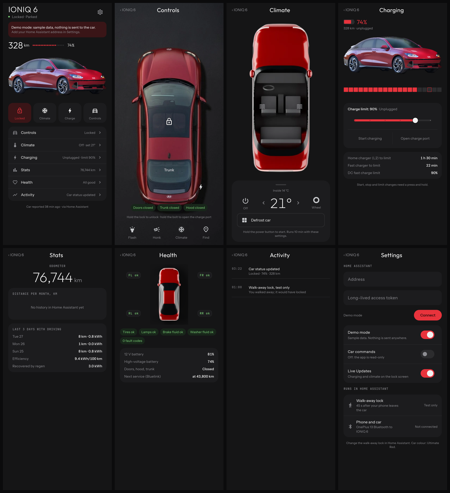

# Ioniq 6 Companion

An Android app (Flutter) for a 2023 Hyundai Ioniq 6. It talks only to Home
Assistant, which already runs the Hyundai/Kia (`kia_uvo`) integration. The app
never logs in to Bluelink itself, so there is only one Bluelink session.



## What's in it

- **Home**: range, charge, lock state and quick actions, with the car as the hero.
- **Controls**: overhead car with the Rive lock, charge port, flash, honk, door status.
- **Climate**: temperature, seat heat, steering wheel, defrost, Rive airflow.
- **Charging**: Rive charge bar, charge limit, start/stop, open port, time estimates.
- **Stats**, **Health**, **Activity** and **Settings**.
- **Home-screen widget** and **Android 16 Live Updates** for charging and climate.

## Safety

- Anything that acts on the car (lock, unlock, climate, charging, charge limit,
  charge port, flash, honk) needs a **press and hold**. A tap only shows a hint.
- **Car commands are off** until you turn them on in Settings. Until then the app is read-only.
- **Demo mode** shows a snapshot of the car and sends nothing anywhere. It's on until
  Home Assistant is set up.

## When Home Assistant or the Hyundai integration is down

- The app keeps the car's **last known state** and the last 360 shots on the phone and
  shows them, with their age, until Home Assistant answers again.
- A banner on Home says **which link is broken**: no internet, Home Assistant unreachable,
  token rejected, Hyundai integration missing, or the integration not getting data from Bluelink.
- Values the app can't know show as **Unknown**, never as OK.
- Commands are refused straight away, with the reason, while the path to the car is broken.
- The car's device and entities are **looked up at each connect**, so removing and re-adding
  the Hyundai integration needs no new build.
- An optional **address on home Wi-Fi** is tried first, so the app works at home without the internet.

## Setup

1. In Home Assistant, open your profile, then Security, and create a long-lived access token.
2. In the app, open Settings, enter the Home Assistant address (for example your
   Tailscale name with `:8123`) and the token, and tap Connect.
3. Turn on Car commands when you're ready to use the controls.

## Building

Every push builds a release APK in GitHub Actions (Actions tab, then the latest
run, then the `ioniq6-companion-apk` artifact). To build locally:

```sh
flutter pub get
flutter test test/store_test.dart test/app_test.dart
flutter build apk --release
```

Screenshots in `test/screenshots/out/` are refreshed with
`flutter test test/screenshots --update-goldens`.

## Updates

The app checks GitHub Releases a few seconds after it opens. When a newer version is out it asks "Download" or "Later" (Later stays quiet for a day for that version), downloads the APK and opens Android's installer. Settings → Check for updates does the same on demand.

To publish a release from the Mac (no Actions minutes), commit and push, then:

```sh
tool/release.sh 0.2.0 "What changed"
```

It builds the APK signed with the release key, checks the signature, and creates release `v0.2.0` with `ioniq6-companion.apk` attached. The versionCode comes from the version (`major*10000 + minor*100 + patch`, so 0.2.0 is 200). Versions must only go up. The Release workflow does the same on GitHub when run by hand (Actions → Release → Run workflow).

Updates only install over a build signed with the same key. The key lives outside the repo at `~/.android/ioniq6-release.jks`, and its passwords are in `android/key.properties`, which git ignores. Keep a copy of both in Bitwarden: if the key is lost, every phone has to uninstall before it can take a new build. To let the workflow sign too, add the same values as repository secrets:

```sh
base64 -i ~/.android/ioniq6-release.jks | gh secret set KEYSTORE_BASE64
gh secret set KEYSTORE_PASSWORD
gh secret set KEY_ALIAS --body ioniq6
gh secret set KEY_PASSWORD
```

## How it talks to Home Assistant

| What | How |
|---|---|
| Live state | WebSocket `subscribe_entities` for the entities in `lib/ha/entities.dart` |
| Commands | REST `POST /api/services/kia_uvo/<service>` with the car's `device_id` |
| Activity | REST `/api/history/period` for the last 48 hours |
| Monthly distance | WebSocket `recorder/statistics_during_period` on the odometer |

The Rive files in `assets/rive/` come from the design work; their inputs are
described in the design folder's Rive README.
