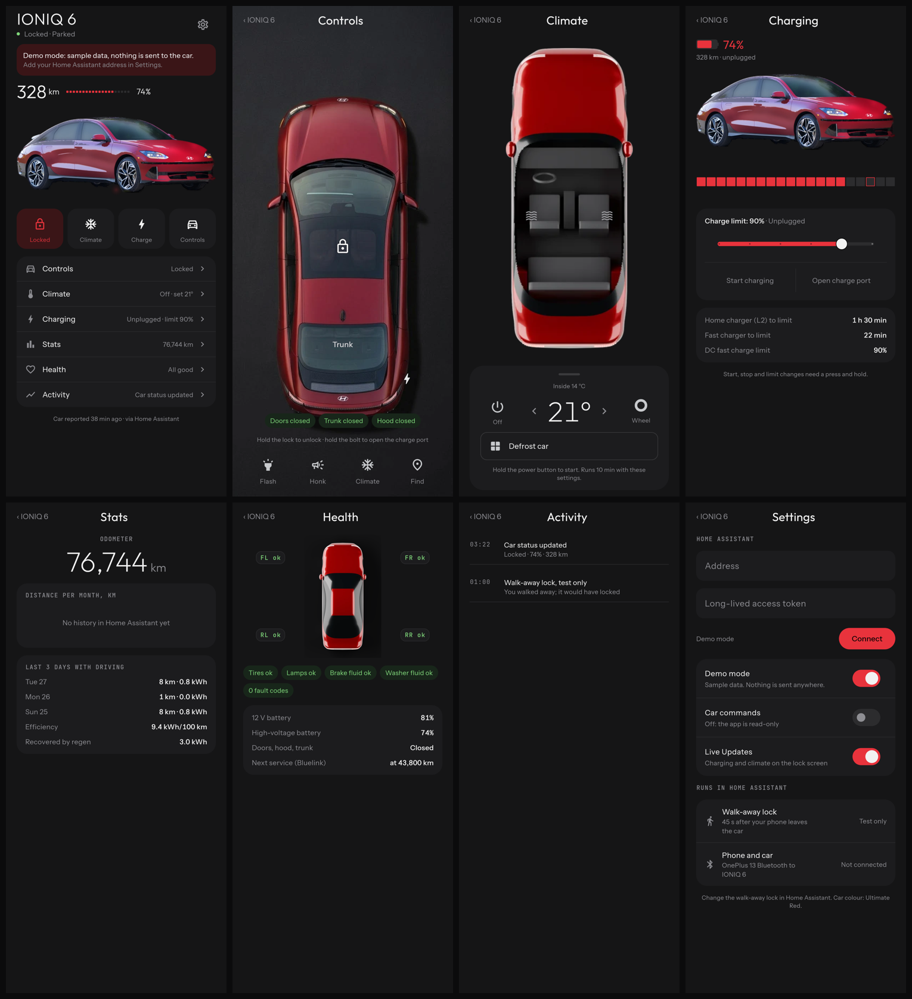

# Ioniq 6 Companion

An Android app (Flutter) for a 2023 Hyundai Ioniq 6. It talks only to Home
Assistant, which already runs the Hyundai/Kia (`kia_uvo`) integration. The app
never logs in to Bluelink itself, so there is only one Bluelink session.



## What's in it

- **Home**: range, charge, lock state and quick actions, with the car as the hero.
- **Controls**: overhead car with the Rive lock, charge port, flash, honk, door status.
- **Climate**: temperature, seat heat, steering wheel, defrost, Rive airflow.
- **Charging**: Rive charge bar, charge limit, start/stop, open port, time estimates.
- **Stats**, **Health**, **Activity** and **Settings**.
- **Home-screen widget** and **Android 16 Live Updates** for charging and climate.

## Safety

- Anything that acts on the car (lock, unlock, climate, charging, charge limit,
  charge port, flash, honk) needs a **press and hold**. A tap only shows a hint.
- **Car commands are off** until you turn them on in Settings. Until then the app is read-only.
- **Demo mode** shows a snapshot of the car and sends nothing anywhere. It's on until
  Home Assistant is set up.

## Setup

1. In Home Assistant, open your profile, then Security, and create a long-lived access token.
2. In the app, open Settings, enter the Home Assistant address (for example your
   Tailscale name with `:8123`) and the token, and tap Connect.
3. Turn on Car commands when you're ready to use the controls.

## Building

Every push builds a release APK in GitHub Actions (Actions tab, then the latest
run, then the `ioniq6-companion-apk` artifact). To build locally:

```sh
flutter pub get
flutter test test/store_test.dart test/app_test.dart
flutter build apk --release
```

Screenshots in `test/screenshots/out/` are refreshed with
`flutter test test/screenshots --update-goldens`.

## Updates

The app checks GitHub Releases a few seconds after it opens. When a newer version is out it asks "Download" or "Later" (Later stays quiet for a day for that version), downloads the APK and opens Android's installer. Settings → Check for updates does the same on demand.

To publish a release, push a tag: `git tag v0.2.0 && git push origin v0.2.0`. The Release workflow builds a signed APK named `ioniq6-companion.apk` and attaches it to the release.

Updates only install over a build signed with the same key, so releases need four repository secrets (never commit the keystore):

```sh
keytool -genkeypair -v -keystore ~/ioniq6-release.jks -alias ioniq6 -keyalg RSA -keysize 4096 -validity 10000
base64 -i ~/ioniq6-release.jks | gh secret set KEYSTORE_BASE64
gh secret set KEYSTORE_PASSWORD
gh secret set KEY_ALIAS --body ioniq6
gh secret set KEY_PASSWORD
```

For local signed builds, put the same values in `android/key.properties` (ignored by git) with `KEYSTORE_PATH=/path/to/ioniq6-release.jks`.

## How it talks to Home Assistant

| What | How |
|---|---|
| Live state | WebSocket `subscribe_entities` for the entities in `lib/ha/entities.dart` |
| Commands | REST `POST /api/services/kia_uvo/<service>` with the car's `device_id` |
| Activity | REST `/api/history/period` for the last 48 hours |
| Monthly distance | WebSocket `recorder/statistics_during_period` on the odometer |

The Rive files in `assets/rive/` come from the design work; their inputs are
described in the design folder's Rive README.
